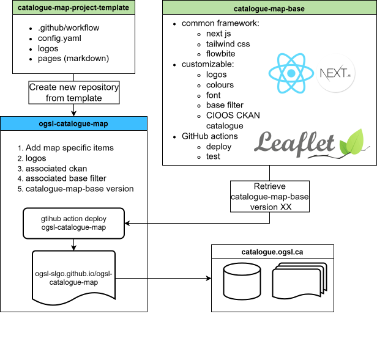

# CIOOS Catalogue Map Base

This project contains the base project use to create and publish CIOOS Catalogue Maps.

## Development

We recommand using the `.devcontainer` with VSCode.

Once in the container:

1. Install dependancies: `npm install`
2. Create a `.env.local` file with a [MapTiler](https://cloud.maptiler.com) API key: `MAPTILER_KEY=your_key_here` (used for the vector basemap; the key's allowed HTTP origins must include `localhost` for local development).
3. Run project in development mode: `npm run dev`
4. Test Static Deployment: `npm build`
5. Static Deployment should be available under the `out` directory. You can then use either an extension like LiveServer to

## Configuration

For a detail documentation of the possible configuration, see [CONFIG.md](CONFIG.md).

## Continous Integration

### Tests

All commits to the `main` and `development` branches or `pull-requests` to the same branches are tested with ESLint.

### Deployment

All changes to the `main` branch update the project page deployment.
